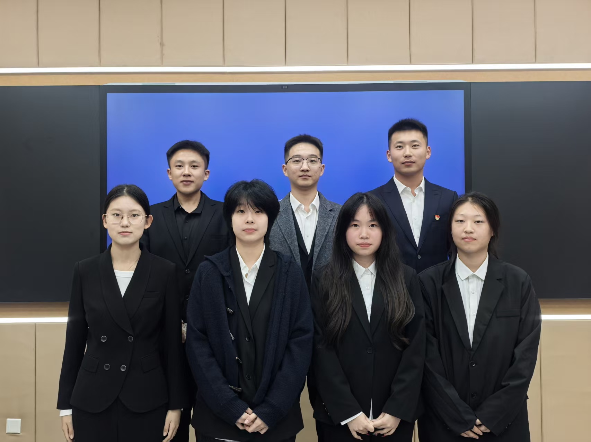
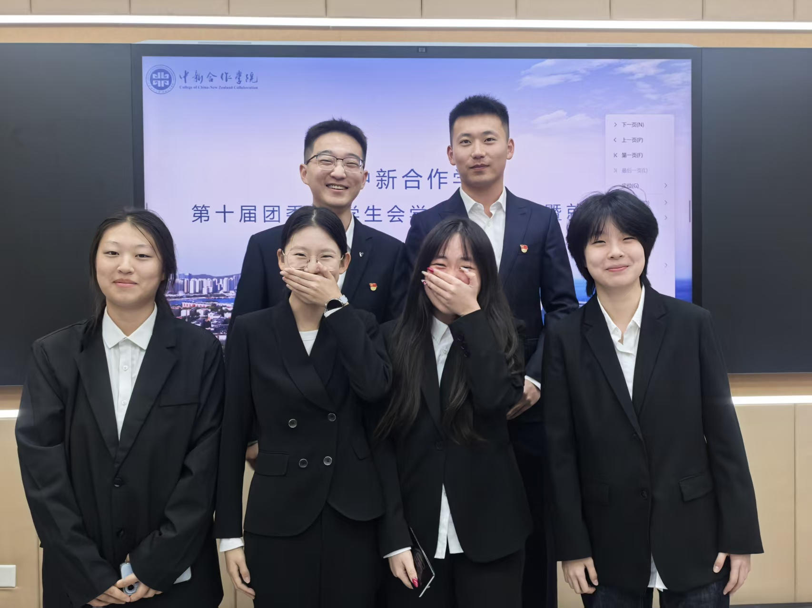
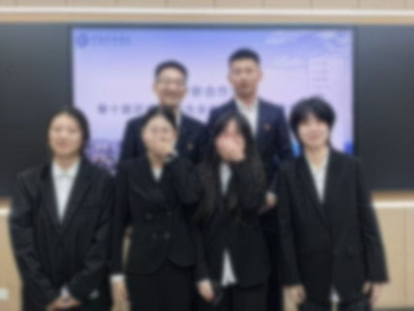
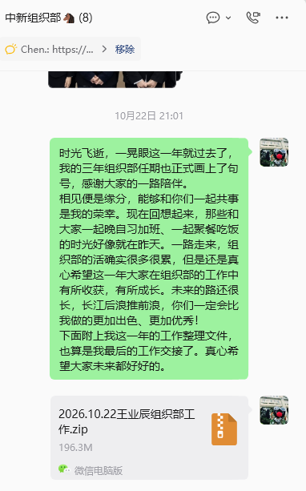

2026年10月22日，学生会迎来了换届，我也终于卸下了肩上的担子。如今已经大四，回头看看，这三年我也为学院做了不少事，投入了不少时间和精力。
{: .prose-paragraph }

与其说舍不得学院的工作，其实我更舍不得这群人。前两年都没有今年这么强烈的感觉。到了第三年，我当上了部长，新来的部员是我自己手把手、一点点带起来的。如今就这样离开，说实话，确实有些舍不得。
{: .prose-paragraph }

记录一下我的团队

在这一天里，我刻意和我的小伙伴们进行了合照，其实我的本意是想留一个纪念在里面，本来的合照是很严肃的，但是耐不住摄影师的一句调侃，大家几乎都没绷住，这个瞬间算是记录下来，拿着这个做纪念，感觉挺美好。
{: .prose-paragraph }

后来，小干事刘又给我发来了一张模糊的版本。

“怎么办怎么办怎么办怎么办”

“这张照片怎么变得这么模糊”

原本照片里大家都在笑，可照片变模糊后，那些笑脸看起来却有点像是在哭。明明是同一张合照，再看时却有了不一样的感觉。
{: .prose-paragraph }

我并未因为离开一份工作岗位而感到如此难过。让我难过的，是看着他们一点点成长，自己却到了要离开的时候。一路走来的陪伴，已经成了生命中一段美好的回忆。工作结束，友谊长存，以前的上下级也都成了朋友。
{: .prose-paragraph }
