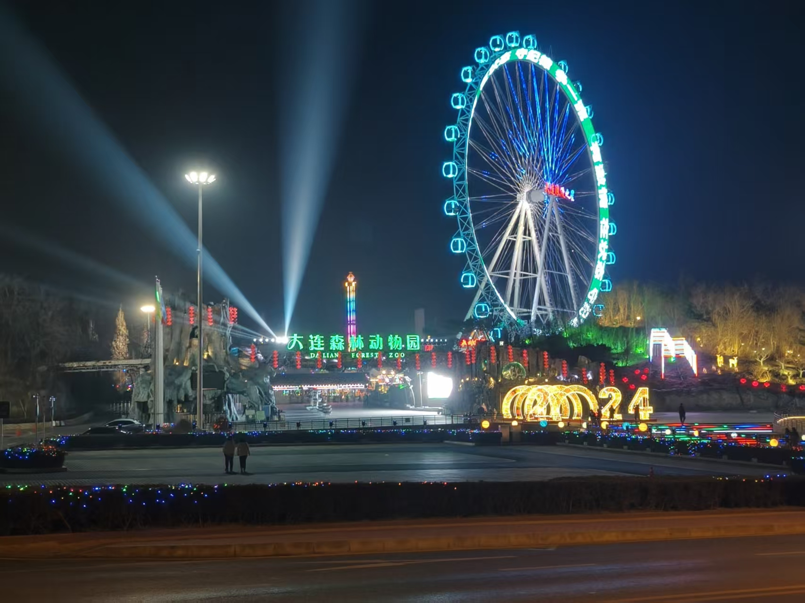
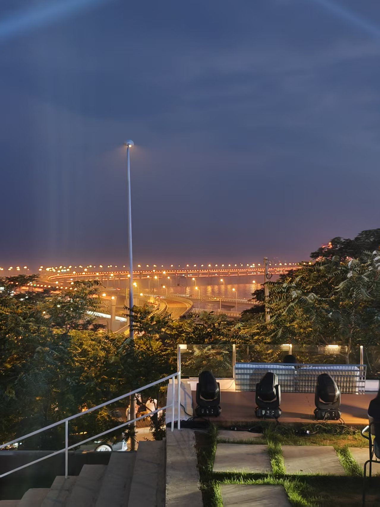
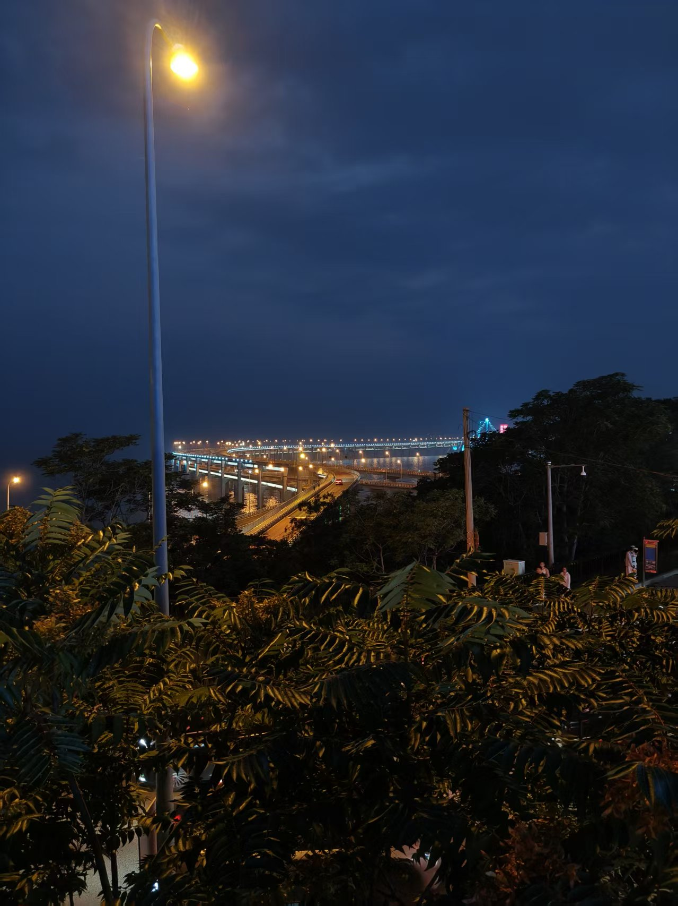
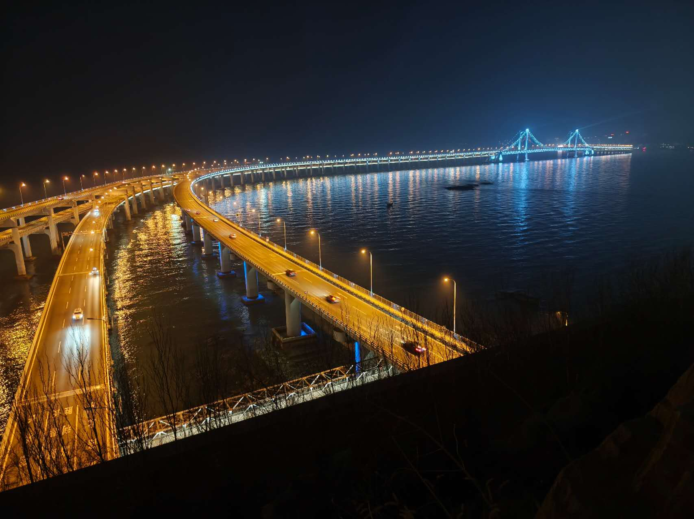

推免和考研，是两条很不一样的升学道路。很多人觉得，保研能够更早确定去向，压力应该也小一些。但真正接触这条路之后，我才发现，提前结束，并不意味着过程轻松。对我而言，压力尤其集中在七、八、九这三个月。那段时间里的焦虑、茫然，以及等待结果时的不确定感，只有身处其中，才知道是什么滋味。
{: .prose-paragraph }

不过，刚上大一的时候，我从来没有考虑过保研。原因很简单：当时学院没有推免名额，这条路并不在我的选择范围内。
{: .prose-paragraph }

那时，我的计划是准备雅思，争取在大四阶段去新西兰交流学习。按照当时交流项目的要求，我需要在大学前三年取得雅思总分6.0的成绩，因此也开始有意识地为考试做准备。相比于一条还不存在的升学路径，出国交流是我当时更明确的目标。
{: .prose-paragraph }

转折发生在大二上学期刚开学的时候。学校给了学院两个推免名额，面向当时已经大四的2021级学长学姐。
{: .prose-paragraph }

刚听到这个消息时，我还没有特别强烈的反应。毕竟距离自己面临升学选择还有一段时间，我也没有立刻改变原来的计划。只是从那时起，我知道，除了出国和考研，还有一条叫作“推免”的路。
{: .prose-paragraph }

直到九月下旬，得知两位学长学姐分别去了山东大学威海校区和中国农业大学，我才第一次真切地受到触动。此前，保研对我来说只是一个新出现的名词；看到他们的去向后，我才意识到，这个机会真的有可能让我们从一所普通本科院校，走向原本觉得有些遥远的平台。
{: .prose-paragraph }

也是从那时起，我开始认真想：这条路，自己有没有可能走一走？
{: .prose-paragraph }

带着这个念头，我找到了保研去山东大学的学长，和他聊了聊。那次交流之后，我对保研多了一些了解，也比之前更心动了。
{: .prose-paragraph }

但心动归心动，真正要调整方向时，我还是犹豫了。保研和我原先的出国规划，需要不同的准备，我得认真考虑接下来把时间和精力放在哪里。更现实的问题是，我当时的成绩排名第四，而学院这一届只有两个推免名额。如果名额一直维持在两个，机会很可能轮不到我。
{: .prose-paragraph }

所以，慎重考虑之后，我没有立刻转向保研，而是决定先保持观望。这条路已经进入了我的视野，但当时的我，还不知道自己究竟有没有机会走上去。
{: .prose-paragraph }

取景地点：跨海大桥观景点
{: .prose-paragraph }
