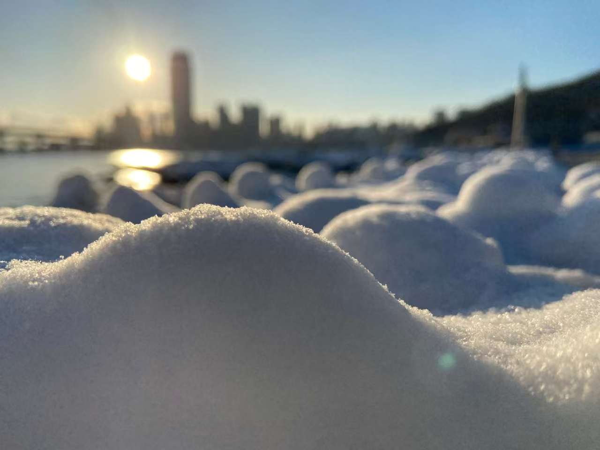
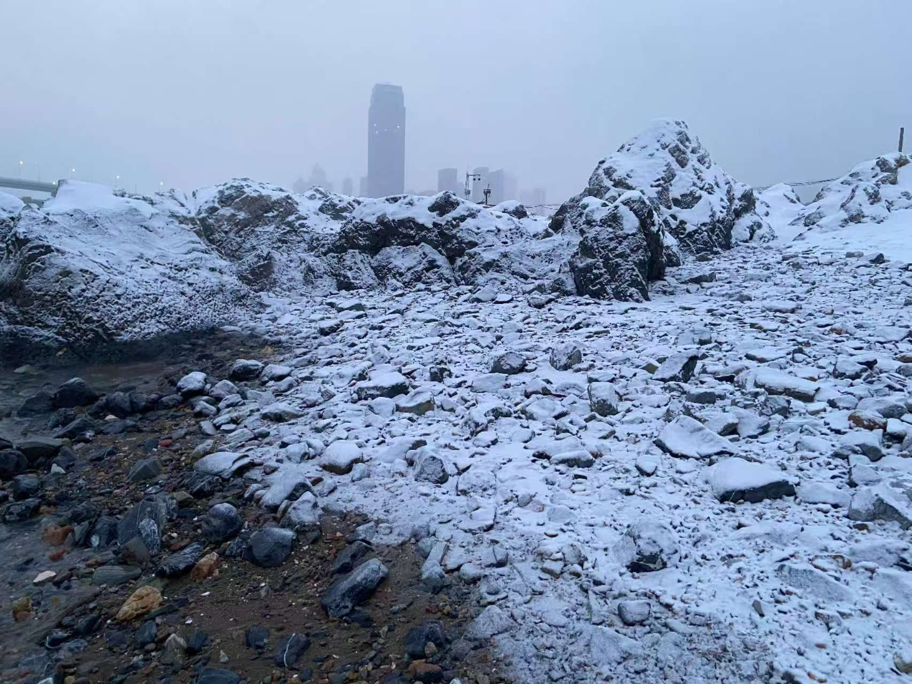
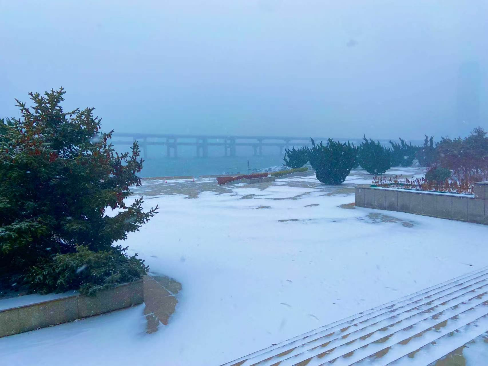
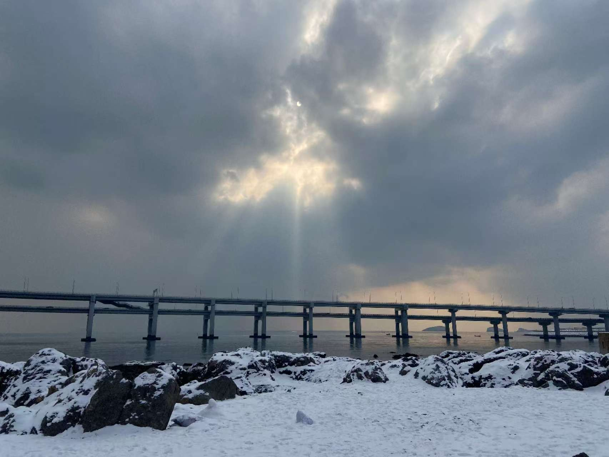

整个大二，我对保研的态度依旧是徘徊观望，但也没有停下脚步。毕竟，单看专业课成绩，前面就已经有三名同学比我靠前，而专业课成绩还只占推免综合成绩的85%。按照当时的计算方式：
{: .prose-paragraph }

> 推免综合成绩＝专业课成绩 × 85%＋科技创新成绩 × 10%＋综合评价成绩 × 5%

这几项里，综合评价主要由老师们进行评定，另外两项则需要自己去争取。于是，在平时忙于学习、英语和学院工作的基础上，我又给自己加了一项新任务：开始一点点接触竞赛。
{: .prose-paragraph }

说实话，刚开始的时候，我心里是有些打鼓的。想参加竞赛，得先有一个项目；想做项目，又得找到一位愿意指导我的老师。可当时的我只是一个大二学生，对这些事情，不能说是一窍不通吧——好吧，也只能是一窍不通了。
{: .prose-paragraph }

项目从哪里来，老师该去找谁，自己又能做些什么，我都没有头绪。光是想着这些问题，就已经觉得有些犯难了。
{: .prose-paragraph }

不过，困扰归困扰，事情总得往前推进。这些还没有答案的问题，始终像一份担子压在肩上。白天被课程和各种事情填满，到了晚上，空下来想想自己的处境，又难免陷入内耗。我也知道，一直想下去，并不会凭空多出一个项目，或者突然就有老师愿意带我。
{: .prose-paragraph }

所以，我开始利用休息时间主动研究竞赛。学校官网上公布的、推免能够加分的竞赛，还有相关白名单里的比赛，都逐渐进入了我的视野。我一个个去看，想从中找出一个自己能够着手尝试的方向。
{: .prose-paragraph }

可越研究，越觉得自己的准备不够。科创类竞赛，我没有属于自己的项目；知识类竞赛，又需要额外花时间学习和准备。以自己当时的水平，能不能获奖，心里也实在没底。原本是想找一条能走的路，结果查着查着，反倒看见了更多自己欠缺的地方。
{: .prose-paragraph }

到了大二下学期，我终于找到了一个可以具体尝试的方向。在查阅学校的竞赛积分记录时，我发现，曾经有一位研究生学长参加物理实验竞赛，获得了国家级三等奖。顺着这条信息，我也开始认真了解这个比赛。
{: .prose-paragraph }

有了想尝试的比赛，接下来就是找指导老师。我找到了教过我大学物理的汪老师，想问问老师是否愿意带我参赛。
{: .prose-paragraph }

不过，汪老师说自己快要退休了，已经不太打算再带学生参加竞赛。听到这里，多少还是有些遗憾。好在，汪老师在这方面很有经验，交流中也问起了我有没有意向的指导老师。后来，在汪老师的推荐下，我联系到了范老师。
{: .prose-paragraph }

就这样，我找到了后来对我帮助很大的范老师，也终于有机会在老师的指导下，认真准备这场物理实验竞赛。此前一直让我犯难的“比赛、项目、指导老师”，总算开始有了着落。
{: .prose-paragraph }

保研的机会依然还不确定，但至少，我已经从查资料、想办法，走到了真正可以动手做点什么的这一步。
{: .prose-paragraph }

取景地点：海洋大学 雪
{: .prose-paragraph }
